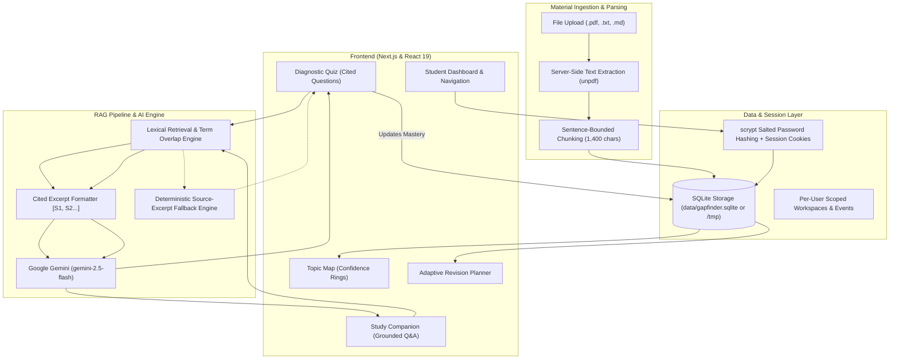

# GapFinder AI — Diagnosing Knowledge Gaps Before the Exam Does

> **GapFinder AI** takes a student’s syllabus, lecture notes, textbook extracts, and past question papers, finds their hidden weak areas through source-grounded diagnostics, and automatically builds an adaptive, personalized revision plan. 
> 
> *Chat can support the experience, but the main output is a diagnosis, not just answers.*

---

## ⚡ Quick Links & Judge Demo Access

| Resource | Details |
| :--- | :--- |
| **Live Application** | Hosted on Vercel |
| **1-Click Demo Login** | Available directly on the login screen (`⚡ 1-Click Judge Demo Login`) |
| **Demo Email** | `judge@gapfinder.ai` |
| **Demo Password** | `JudgeDemo2026!` |
| **Preloaded Material** | *Computer Systems & Operating Systems* (Processes, Virtual Memory, Concurrency, Deadlocks, Storage) |

---

## 1. Problem Statement

Students frequently study everything equally before exams, wasting hours reviewing topics they already grasp while critical conceptual gaps remain untouched. Traditional study tools and AI chatbots are purely reactive—they wait for the student to ask a question. However, **a student cannot ask about a gap they do not know they have.**

**GapFinder AI** addresses this by:
1. **Mapping Syllabi & Notes**: Automatically organizing unstructured course materials into topic hierarchies.
2. **Grounded Diagnostic Testing**: Generating quiz questions tied directly to the student’s own notes, with verbatim source citations.
3. **Objective Gap Analysis**: Categorizing topics into **Needs Focus** (<55%), **Building** (55–79%), and **Strong** (≥80%) based on diagnostic performance.
4. **Adaptive Revision Planning**: Structuring study sessions ordered by lowest topic confidence and available study time.
5. **Grounded Explanations**: Answering student inquiries with strict source citations (`[S1]`, `[S2]`) to eliminate hallucinations.

---

## 2. Architecture Overview

GapFinder AI is built with **Next.js (App Router)**, **TypeScript**, and **Tailwind CSS**, integrating serverless API endpoints with **Google Gemini (2.5 Flash)** and a persistent SQLite data layer.



---

## 3. RAG Pipeline & AI Workflow

Judges can verify clear separation between **Retrieval** and **Generation**:

### A. Document Chunking
- When documents are uploaded, text is normalized and split across paragraph and section boundaries.
- Chunks are bounded to **1,400 characters** with section header tracking (e.g., `# Virtual Memory & Paging Mechanisms`).
- Each chunk preserves metadata: `title`, `section`, and `quote`.

### B. Retrieval Mechanism
- **Scoring**: Queries (from the student or the diagnostic generator) are stripped of common stop words. Candidate chunks are scored via unique term matches and normalized keyword density.
- **Top-K Ranking**: The top matching chunks are extracted and assembled into a context payload.
- **Strict Grounding Constraint**: The prompt instructs the model to answer **only** using the provided excerpts and cite each source as `[S1]`, `[S2]`, etc. External ungrounded facts are strictly forbidden.

### C. Question Generation & Semantic Evaluation
- **Question Generation**: Diagnostic MCQs are constructed from the retrieved excerpts, producing questions where each distractor and correct answer is grounded in the source text.
- **Answer Evaluation**: Explains *why* the student's answer was correct or incorrect, citing the exact document title and section.
- **Zero-Failure Fallback Engine**: If no API key is provided or the LLM request limits out, GapFinder activates a built-in deterministic fallback engine that synthesizes questions and feedback directly from source excerpts, ensuring the app never breaks.

### D. Gap Diagnosis & Adaptive Revision Algorithm
- Initial topic confidence is **Unassessed**.
- Diagnostic quiz results dynamically calculate topic mastery scores:
  - **Needs Focus** (<55%): Critical concept gaps; scheduled first.
  - **Building** (55%–79%): Partial understanding; scheduled for reinforcement.
  - **Strong** (≥80%): Solid mastery; scheduled for periodic review.
- The revision plan automatically re-sorts tasks based on topic gap priority and available study time.

---

## 4. Features Checklist

- [x] **Material Upload**: Accepts PDF, TXT, and Markdown documents with server-side extraction.
- [x] **Topic Map**: Automatically builds topic cards with confidence meters and source links.
- [x] **Diagnostic Quiz**: Grounded questions with source citations for every question and answer.
- [x] **Gap Report**: Visual mastery ring, prioritized topic ranking, and category breakdown.
- [x] **Personalized Revision Plan**: Dynamic timeline tasks with duration estimates and completion tracking.
- [x] **Explain-This-Topic Assistant**: Grounded tutor citing source documents and sections.
- [x] **Progress Dashboard**: Tracks completed diagnostics, study time, and session history.
- [x] **Secure Authentication**: Salted scrypt hashing, HTTP-only secure cookies, and per-user data scoping.
- [x] **Judge Demo Access**: 1-click login and preloaded Operating Systems syllabus and diagnostic data.

---

## 5. Local Setup Instructions

### Prerequisites
- **Node.js**: v20 or newer (v22 recommended)
- **npm**: v10 or newer

### Installation

```bash
# 1. Clone repository
git clone https://github.com/Sathwik-7-k/GAPFINDERAI.git
cd GAPFINDERAI

# 2. Install dependencies
npm install

# 3. (Optional) Configure Gemini API Key
# Copy example env or create .env.local
```

Create a `.env.local` file in the root directory:

```env
GEMINI_API_KEY=your_gemini_api_key_here
GEMINI_MODEL=gemini-2.5-flash
```

> **Note**: A Gemini API key enables generative question synthesis and semantic evaluation. If omitted, GapFinder seamlessly runs on its deterministic retrieval engine without crashing.

### Run the Development Server

```bash
npm run dev
```

Open [http://localhost:3000](http://localhost:3000) in your browser.

---

## 6. Deployment Guide (Vercel)

GapFinder is optimized for zero-config Vercel deployment:

1. Push your repository to GitHub.
2. Sign in to [Vercel](https://vercel.com/) and click **"Add New Project"** > import `GAPFINDERAI`.
3. In **Environment Variables**, add:
   - `GEMINI_API_KEY`: Your Google AI Studio API key.
   - `GEMINI_MODEL`: `gemini-2.5-flash`
4. Click **Deploy**.

> **Serverless Storage Note**: On Vercel serverless functions, GapFinder automatically detects the serverless environment and stores SQLite in `/tmp/gapfinder.sqlite`. The preloaded judge demo account is auto-seeded on initialization.

---

## 7. Limitations & Future Scalability

- **Optical Character Recognition (OCR)**: Currently parses text-based PDFs. Image-only scanned PDFs require client- or server-side OCR (e.g., Tesseract.js).
- **Vector Embedding Store**: Next architectural step is integrating `pgvector` or Supabase Vector with Gemini embeddings (`text-embedding-004`) for hybrid lexical-semantic search.
- **Spaced Repetition (SRS)**: Planned integration of the SuperMemo (SM-2) algorithm for optimal revision interval reminders.
- **Teacher & Class Analytics**: Aggregate view allowing teachers to inspect class-wide topic weaknesses without exposing private student documents.